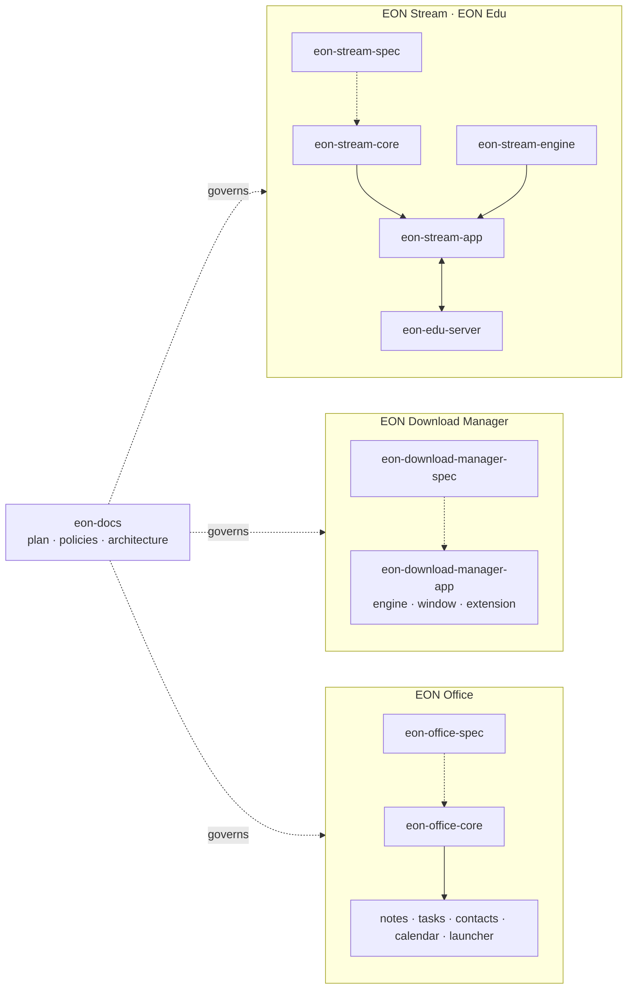

<h1 align="center">EON</h1>

<strong>Extensible Open Network</strong>

<em>An open ecosystem for everyone.</em>

  <a href="https://github.com/EON-Extensible-Open-Network/eon-docs/blob/main/plan/eon-plan.md">Project plan</a> ·
  <a href="https://github.com/EON-Extensible-Open-Network/eon-docs/blob/main/docs/architecture.md">Architecture</a> ·
  <a href="https://github.com/EON-Extensible-Open-Network/.github/blob/main/CONTRIBUTING.md">Contributing</a>

---

EON is an umbrella, not a product. Everything under it is open source, non-profit, free for
the people who use it, and sends no telemetry.

**Every service is its own product** (plan madde 45): its own repositories, its own core, its
own application, its own release line. You install what you use and nothing else. A product
uses another product's core only where that is genuinely more efficient than duplicating it;
what the products share is not code but contracts and umbrella-wide decisions — licensing,
signing, accessibility, localisation, no telemetry.

## Products

| Product | What it is | Stage |
|---|---|---|
| **EON Stream** | Video. A media viewer that speaks the Stremio addon protocol, streams BitTorrent sequentially and plays with mpv, on a core where everything is a module. | alpha line, `v0.3` |
| **EON Edu** | EON Stream's core, compiled as an institutional product for schools. The open marketplace, arbitrary addon URLs and open BitTorrent are absent at compile time, and CI checks it. | planned (Faz 3) |
| **EON Download Manager** | Files. Several connections per file, split and rebalanced while they run; resume after anything; a new link for an expired one; downloads caught from the browser. | alpha, `v0.0.0` |
| **EON Office** | Productivity: Notes, Tasks, Contacts, Calendar — separate applications on a shared library core. | alpha, parked for a redesign |
| **Audio** | Music and audio as a product of its own; name and scope still open. | deferred |

## Architecture

Contracts come first in every product. The parts that cannot change later without breaking
other people's work — an addon API, a browser hand-off, a file format — live in a `-spec`
repository under a permissive licence, versioned apart from any implementation. Cores are
libraries, not services: an application links its core and runs on its own.

## Repositories

Naming follows `eon-<product>-<component>`; repositories that belong to the umbrella carry no
product name.

| Repository | What it is | Licence |
|---|---|---|
| **Umbrella** | | |
| [eon-docs](https://github.com/EON-Extensible-Open-Network/eon-docs) | The numbered plan, policies, architecture, per-product research and status | `CC-BY-SA-4.0` |
| [.github](https://github.com/EON-Extensible-Open-Network/.github) | This page, contributing guide, code of conduct, security, governance, trademark | `CC0-1.0` |
| **EON Stream · EON Edu** | | |
| [eon-stream-spec](https://github.com/EON-Extensible-Open-Network/eon-stream-spec) | Addon API, manifest and package schemas, module ABI, signing | `Apache-2.0` |
| [eon-stream-core](https://github.com/EON-Extensible-Open-Network/eon-stream-core) | Module manager, addon protocol client, signature verification, updater | `GPL-3.0-or-later` + module exception |
| [eon-stream-engine](https://github.com/EON-Extensible-Open-Network/eon-stream-engine) | BitTorrent, sequential streaming, loopback HTTP, mpv IPC | `GPL-3.0-or-later` + module exception |
| [eon-stream-app](https://github.com/EON-Extensible-Open-Network/eon-stream-app) | The desktop application; the EON Stream and EON Edu build profiles | `GPL-3.0-or-later` + module exception |
| [eon-stream-community](https://github.com/EON-Extensible-Open-Network/eon-stream-community) | Reference server for ratings and comments; runnable by anyone, not operated by the project | `AGPL-3.0-or-later` |
| [eon-stream-sdk](https://github.com/EON-Extensible-Open-Network/eon-stream-sdk) | Addon author tooling | `MIT` |
| [eon-stream-marketplace](https://github.com/EON-Extensible-Open-Network/eon-stream-marketplace) | Git-based addon index and review tooling | `CC0-1.0` / `Apache-2.0` |
| [eon-edu-server](https://github.com/EON-Extensible-Open-Network/eon-edu-server) | Institution server | `AGPL-3.0-or-later` |
| **EON Download Manager** | | |
| [eon-download-manager-spec](https://github.com/EON-Extensible-Open-Network/eon-download-manager-spec) | Browser hand-off over native messaging, the `.eondl` resume state | `Apache-2.0` |
| [eon-download-manager-app](https://github.com/EON-Extensible-Open-Network/eon-download-manager-app) | The engine, the window and the browser extension | `GPL-3.0-or-later` + module exception |
| **EON Office** | | |
| [eon-office-spec](https://github.com/EON-Extensible-Open-Network/eon-office-spec) | The shared-folder contract, app manifest, capabilities, sync | `Apache-2.0` |
| [eon-office-core](https://github.com/EON-Extensible-Open-Network/eon-office-core) | The library every Office application links: storage, search, sync, preferences | `GPL-3.0-or-later` + module exception |
| [eon-office-sdk](https://github.com/EON-Extensible-Open-Network/eon-office-sdk) | Client library and reference integration | `MIT` |
| [eon-office-launcher](https://github.com/EON-Extensible-Open-Network/eon-office-launcher) | Install and manage Office applications | `GPL-3.0-or-later` + module exception |
| [eon-office-marketplace](https://github.com/EON-Extensible-Open-Network/eon-office-marketplace) | The Office application index | `CC0-1.0` / `Apache-2.0` |
| [eon-office-notes](https://github.com/EON-Extensible-Open-Network/eon-office-notes) · [tasks](https://github.com/EON-Extensible-Open-Network/eon-office-tasks) · [contacts](https://github.com/EON-Extensible-Open-Network/eon-office-contacts) · [calendar](https://github.com/EON-Extensible-Open-Network/eon-office-calendar) | The first Office applications | `GPL-3.0-or-later` + module exception |

## What EON is not

Stated up front because it defines the project as much as any feature list:

- It sends **no telemetry**. Not off-by-default-but-present: absent.
- It **hosts no content**. EON Stream ships with no sources and no addons preinstalled, ever.
- It asks **nothing that is not needed** and holds no data about anything outside its own
  applications; what it does keep, it says plainly.
- Its free products carry **no licensing code** — not disabled, absent.
- It stores **no Turkish national ID numbers** and holds **no student data**; in EON Edu the
  institution is the data controller and runs its own server.

## Contributing

Read [CONTRIBUTING.md](https://github.com/EON-Extensible-Open-Network/.github/blob/main/CONTRIBUTING.md) and the
[Code of Conduct](https://github.com/EON-Extensible-Open-Network/.github/blob/main/CODE_OF_CONDUCT.md). Contributions
are taken under the DCO — sign off your commits with `git commit -s`. The
[plan](https://github.com/EON-Extensible-Open-Network/eon-docs/blob/main/plan/eon-plan.md) is the roadmap; its
decisions are numbered and permanent, and code that contradicts it is a bug in one of the two.

Security issues: [SECURITY.md](https://github.com/EON-Extensible-Open-Network/.github/blob/main/SECURITY.md) — never a
public issue.

---

  
    The code is free; the name is not — see
    <a href="https://github.com/EON-Extensible-Open-Network/.github/blob/main/TRADEMARK.md">TRADEMARK.md</a>. 
    EON Stream is not affiliated with, endorsed by, or connected to Stremio.
  

